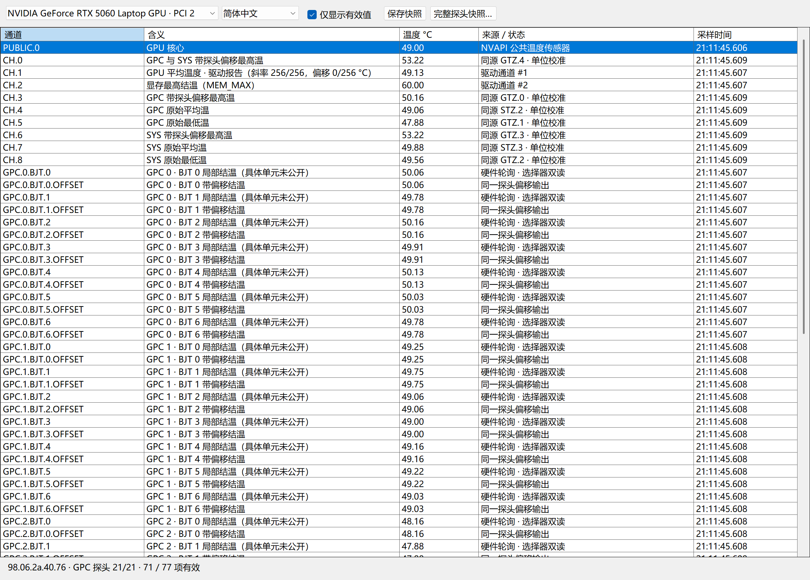

# RTX 50 Per-GPC Temperatures

[简体中文](README.md) · **English**

Read local junction temperatures from individual BJT probes in each GPC, along with GPU thermal zones and VRAM temperatures. Verified on the **GeForce RTX 5060 Laptop GPU** and **GeForce RTX 5080 Laptop GPU**.

For example, `GPC.1.BJT.5` identifies probe 5 in cluster 1 of the thermal selector. **The selector's GPC numbers may differ from the physical GPC numbers in the GPU's compute topology.** A BJT number alone does not identify an SM, TPC, or die coordinate.

## Usage

On Windows x64, install the [.NET 9 Desktop Runtime for x64](https://dotnet.microsoft.com/download/dotnet/9.0). Double-click `Rtx50Temps.exe` to open the live monitor. The executable requests administrator privileges at startup. It temporarily changes the thermal selector to read each BJT and verifies that the selector has been restored after each cluster.

The first launch uses Simplified Chinese on a Chinese-language system and English elsewhere. Use the language menu next to the GPU list to switch at any time. The app remembers your choice and scales the window to the DPI of its current monitor.

The same executable runs as a CLI in an **elevated PowerShell**. Use `--lang en` or `--lang zh` to override the language for one run. JSON field names, channel IDs and numeric temperature formats are the same in both languages.

~~~powershell
.\Rtx50Temps.exe --list
.\Rtx50Temps.exe --lang en --once --json
.\Rtx50Temps.exe --gpu 0 --watch 1
.\Rtx50Temps.exe --gpu 0 --full-scan snapshot.json
~~~

To build from source, install the .NET 9 SDK and run `.\build.ps1` from the repository root. The resulting single executable, `dist/win-x64/Rtx50Temps.exe`, uses the installed desktop runtime.

## License

The project uses [GPL-3.0-only](LICENSE) with a [section 7 additional permission for NVIDIA NVAPI](NVAPI-EXCEPTION.txt). It loads the system-installed NVIDIA NVAPI at runtime.
