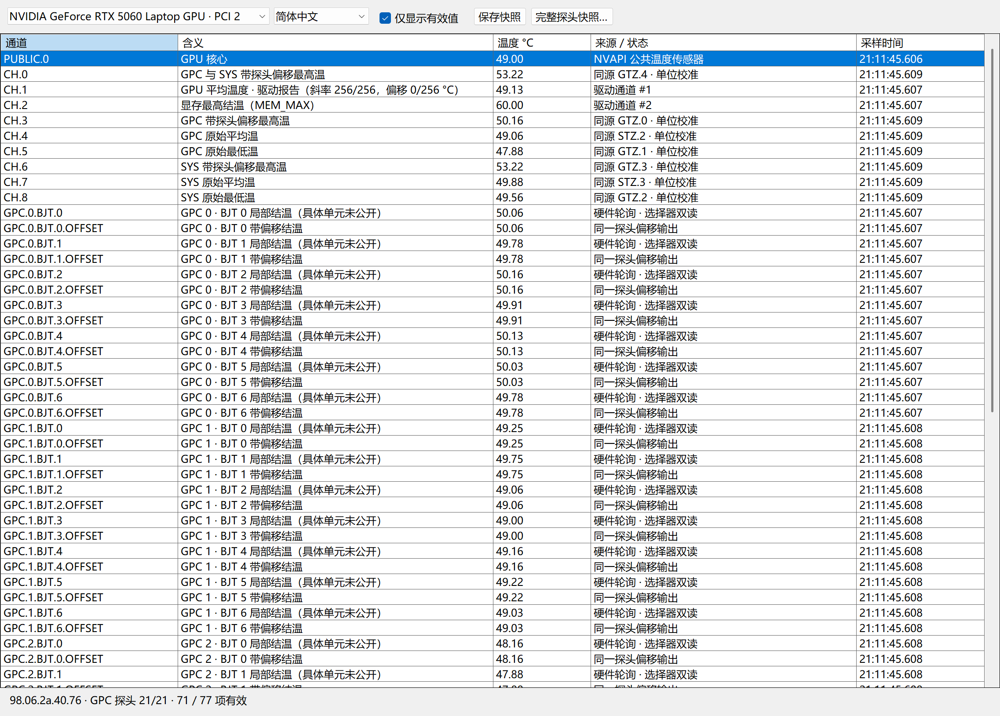

# RTX 50 Per-GPC Temperatures

**简体中文** · [English](README.en.md)

查看每个 GPC 内各个 BJT 的局部结温，以及 GPU 温区和显存温度。已在 **GeForce RTX 5060 Laptop GPU** 和 **GeForce RTX 5080 Laptop GPU** 上验证可用。

例如，`GPC.1.BJT.5` 表示温度选择器 1 的探头 5。程序连接显卡时直接通过 NVIDIA 驱动读取这块 GPU 的逻辑 GPC 到硬件 GPC（chiplet ID）映射。在实测的 5060 Laptop 上，这一行显示“逻辑 GPC 0 · 硬件 GPC 1（选择器同号）”。BJT 编号本身不能确定 SM、TPC 或裸片坐标。

## 使用

在 Windows x64 上安装 [.NET 9 桌面运行时（x64）](https://dotnet.microsoft.com/download/dotnet/9.0)，双击 `Rtx50Temps.exe` 打开实时温度窗口。程序默认请求管理员权限。逐个读取 BJT 时，程序临时切换温度选择器，每读完一簇便核验一次恢复状态。

首次启动时，中文系统使用简体中文，其他系统使用英文。用显卡列表旁的语言菜单即可切换，程序会记住选择。窗口随所在显示器的 DPI 缩放。

在**管理员 PowerShell** 中给同一个程序传入参数即可使用 CLI。`--lang zh` 或 `--lang en` 只指定本次运行的语言。JSON 的字段名、通道 ID 和温度数值格式在两种语言下相同。

~~~powershell
.\Rtx50Temps.exe --list
.\Rtx50Temps.exe --lang zh --once --json
.\Rtx50Temps.exe --gpu 0 --watch 1
.\Rtx50Temps.exe --gpu 0 --full-scan snapshot.json
~~~

安装 .NET 9 SDK 后，在仓库根目录运行 `.\build.ps1` 即可构建 `dist/win-x64/Rtx50Temps.exe`。该单文件程序使用系统安装的桌面运行时。

### GPC 编号的含义

驱动拓扑表按逻辑 GPC 编号排列。程序用硬件启用掩码核对表项，确认每个启用的硬件 GPC 恰好出现一次。JSON 快照的 `logical_to_hardware_gpc` 数组保存这组对应关系。例如，`[1, 0, 2]` 表示逻辑 GPC 0 对应硬件 GPC 1。读取失败或校验未通过时该字段为 `null`。

温度选择器使用独立编号。仅当选择器编号集合与启用的硬件 GPC 编号集合完全一致时，BJT 原温和偏移行才显示同号硬件 GPC 对应的逻辑编号，并标记 `gpc.association = "matching_chiplet_id"`。这种关联已在一块 5060 Laptop 上通过逐 SM 温升验证，其他卡仍需独立验证。无法关联时保留温度和选择器编号，逻辑和硬件编号为 `null`。

## 许可

项目代码采用 [GPL-3.0-only](LICENSE)，附[仅针对 NVIDIA NVAPI 的第 7 条附加许可](NVAPI-EXCEPTION.txt)。运行时调用系统已安装的 NVIDIA NVAPI。
